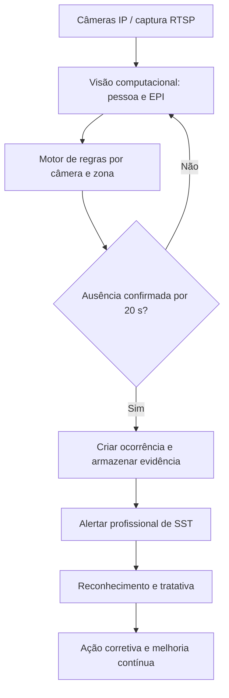
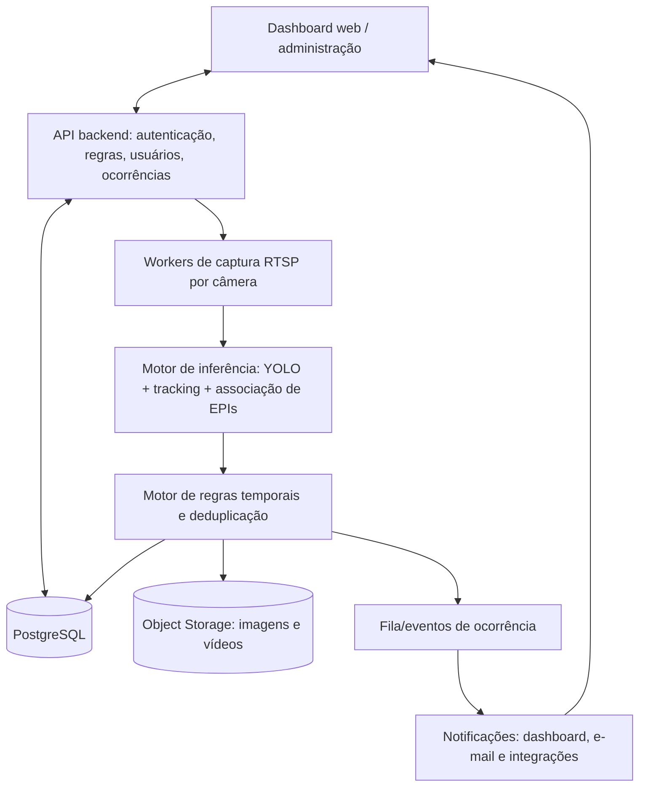

# P300 Vision Safety

**Especificação de Requisitos de Software (SRS) — Versão 1.0**  
**Produto:** Sistema Inteligente de Monitoramento de EPIs e Prevenção de Riscos Ocupacionais  
**Contexto:** Indústria de transformação de vidros para eletrodomésticos  
**Data:** 09/11/2026  
**Status:** Proposta para refinamento e validação com o cliente e equipe de SST  
**Repositório de referência:** [P300-Cognitive/ppe-detection — feature/schott-vision-first-version](https://github.com/P300-Cognitive/ppe-detection/tree/feature/schott-vision-first-version)

---

## 1. Visão do produto

O objetivo é evoluir o protótipo de detecção de Equipamentos de Proteção Individual (EPIs) para uma **plataforma de monitoramento contínuo de segurança ocupacional**. Utilizando inteligência artificial e visão computacional, a aplicação deverá identificar condições de não conformidade, gerar evidências, notificar profissionais responsáveis e acompanhar ações corretivas.

A solução será aplicada inicialmente em uma indústria de transformação de vidro para eletrodomésticos, mas sua arquitetura deverá admitir uso futuro em outras operações industriais.

### 1.1 Objetivos de negócio

1. Reduzir a exposição de trabalhadores a riscos relacionados à ausência de EPIs obrigatórios.
2. Automatizar a identificação de condições inseguras em áreas monitoradas.
3. Reduzir o tempo entre a identificação do desvio e a intervenção da equipe de Segurança do Trabalho.
4. Gerar evidências rastreáveis para análise e acompanhamento.
5. Disponibilizar indicadores por área, câmera, turno e tipo de EPI.
6. Apoiar a prevenção e melhoria contínua com práticas de Lean Safety.

### 1.2 Fluxo operacional



### 1.3 Premissas

- O prazo padrão para confirmação de uma violação será de **20 segundos de ausência confirmada**.
- A configuração de EPI obrigatório será estabelecida segundo a área e o risco ocupacional, por profissionais autorizados de SST.
- Uma pessoa pode apresentar mais de um EPI ausente simultaneamente.
- O monitoramento continuará executando no servidor mesmo que ninguém esteja visualizando a câmera.
- O protótipo existente será a base de evolução; substituições tecnológicas dependerão de avaliação de impacto.
- A identificação de pessoas será baseada inicialmente em rastreamento temporário, **sem reconhecimento facial**.

---

## 2. Escopo e avaliação preliminar do protótipo

O repositório de referência está na branch `feature/schott-vision-first-version`. A descrição anterior do projeto aponta uma base em Python, Flask, YOLOv8, ByteTrack, SQLAlchemy e cenários BDD com Behave, além de recursos de RTSP, detecção, associação de EPIs, evidências e alertas.

> **Nota:** Essa é uma avaliação preliminar baseada na documentação descrita anteriormente, não uma auditoria integral do código. Antes do planejamento executivo, as capacidades efetivamente implementadas devem ser verificadas no repositório e em execução.

| Capacidade | Base relatada no protótipo | Evolução prevista |
|---|---|---|
| Câmeras IP | Captura/cadastro RTSP básico | Cadastro, teste, ativação, estados e configuração sem reinicialização |
| Detecção | Pessoas, EPIs e rastreamento | Regras por câmera/zona e tratamento de incerteza |
| Persistência temporal | Confirmações associadas a frames | Contagem contínua por timestamps, em segundos reais |
| Ocorrências | Alertas/histórico básicos | Estados, responsáveis, tratativas e auditoria |
| Evidências | Imagens e vídeos | Integridade, retenção, vínculo e controle de acesso |
| Notificações | Canais de alerta existentes | Alerta interno, reconhecimento e escalonamento |
| Dashboard | Visualização e relatórios | Seleção de câmeras, estados e gestão visual Lean |
| Administração | Parâmetros do sistema | RBAC, versionamento, trilhas e observabilidade |

### 2.1 Fora do escopo do MVP

- Identificação biométrica ou reconhecimento facial de trabalhadores.
- Aplicação automática de sanções disciplinares.
- Substituição da inspeção humana e dos procedimentos de SST.
- Integrações corporativas complexas, salvo se indispensáveis para a primeira implantação.
- Análises preditivas avançadas sem dados históricos validados.

---

## 3. Perfis de usuário

| Perfil | Responsabilidades e permissões propostas |
|---|---|
| Administrador | Cadastrar câmeras, configurar conexões, gerenciar usuários e parâmetros técnicos |
| Gestor de SST | Definir regras e EPIs, acompanhar indicadores, atribuir responsáveis e validar tratativas |
| Profissional de SST | Receber alertas, reconhecer, investigar, tratar e registrar ações |
| Operador/Monitor | Visualizar câmeras e ocorrências conforme permissão, sem alterar políticas críticas |
| Auditor/Consulta | Consultar histórico, evidências e registros autorizados, sem edição |

A matriz final de permissões deverá ser validada com a política de segurança e privacidade da empresa.

---

## 4. Requisitos funcionais

Os identificadores `RF` serão mantidos para rastreabilidade entre especificação, backlog, código, testes e homologação.

### Épico 1 — Cadastro e gerenciamento de câmeras IP

**Objetivo:** possibilitar que um administrador configure e opere câmeras sem mudanças de código ou indisponibilidade geral.

| ID | Requisito | Prioridade |
|---|---|---|
| RF-001 | Cadastrar câmera IP com nome, descrição, endereço RTSP, fabricante, setor e localização | Alta |
| RF-002 | Configurar e armazenar credenciais de conexão de forma segura | Alta |
| RF-003 | Testar conectividade e visualizar uma imagem antes da ativação | Alta |
| RF-004 | Ativar, pausar, desativar e reativar individualmente a monitoria | Alta |
| RF-005 | Configurar resolução, FPS de processamento e parâmetros de captura | Alta |
| RF-006 | Identificar câmera offline, erro de autenticação ou falha de transmissão | Alta |
| RF-007 | Reconectar automaticamente após falhas temporárias | Alta |
| RF-008 | Aplicar alterações sem interromper o funcionamento das demais câmeras | Alta |
| RF-009 | Exibir estado operacional e horário da última imagem válida | Alta |
| RF-010 | Agrupar câmeras por unidade, setor e linha de produção | Média |

**Critérios de aceite:** administrador cadastra, testa, configura EPIs e ativa uma câmera pela interface; o sistema exibe seu estado e não reinicia o monitoramento das demais câmeras.

### Épico 2 — Configuração de EPIs e áreas monitoradas

**Objetivo:** estabelecer os EPIs obrigatórios para cada câmera e, quando aplicável, por região do enquadramento.

| ID | Requisito | Prioridade |
|---|---|---|
| RF-011 | Exibir catálogo de EPIs efetivamente suportados pelo modelo ativo | Alta |
| RF-012 | Selecionar os EPIs obrigatórios por câmera | Alta |
| RF-013 | Definir período mínimo de ausência, com padrão de 20 segundos | Alta |
| RF-014 | Ajustar limiar de confiança para cada EPI ou classe de detecção | Alta |
| RF-015 | Desenhar regiões de interesse (ROI) por polígonos sobre a imagem | Alta |
| RF-016 | Configurar regras específicas para zonas distintas da mesma câmera | Média |
| RF-017 | Definir horários ou turnos de aplicação de regras | Média |
| RF-018 | Reutilizar perfis de monitoramento por área ou atividade | Média |
| RF-019 | Impedir ativação de regra cujo EPI não seja suportado pelo modelo selecionado | Alta |
| RF-020 | Registrar responsável, data e versão de cada alteração de configuração | Alta |

**Exemplo ilustrativo — Linha de Corte 01:** óculos de proteção, luvas apropriadas e calçado de segurança podem ser EPIs exigidos, conforme avaliação de risco. Capacete, colete e demais EPIs não devem ser presumidos obrigatórios sem decisão da equipe de SST.

**Critérios de aceite:** a configuração pode ser persistida, consultada e modificada por usuário autorizado, com rastreabilidade e validação dos EPIs disponíveis.

### Épico 3 — Detecção, rastreamento e validação temporal

**Objetivo:** identificar pessoas em zonas monitoradas e confirmar persistência de ausência de EPI.

| ID | Requisito | Prioridade |
|---|---|---|
| RF-021 | Detectar pessoas em frames da câmera | Alta |
| RF-022 | Atribuir identificador temporário de rastreamento a cada pessoa | Alta |
| RF-023 | Detectar EPIs e associá-los à pessoa correta | Alta |
| RF-024 | Avaliar as regras correspondentes à câmera e à zona | Alta |
| RF-025 | Iniciar contagem após confirmação suficiente da ausência de EPI | Alta |
| RF-026 | Gerar ocorrência após 20 segundos de ausência contínua confirmada | Alta |
| RF-027 | Encerrar ou reiniciar a contagem se a condição deixar de existir | Alta |
| RF-028 | Tratar oclusões, perdas de rastreamento e incerteza visual | Alta |
| RF-029 | Evitar ocorrências duplicadas para uma mesma violação contínua | Alta |
| RF-030 | Mostrar pessoas, EPIs ausentes e estado de avaliação sobre a imagem | Alta |
| RF-031 | Permitir validação e ajuste do modelo diante das condições reais da fábrica | Alta |

**Critérios de aceite:** uma pessoa detectada sem EPI obrigatório por 20 segundos confirmados gera uma ocorrência, enquanto a correção anterior ao limite não gera ocorrência. Não há duplicidade durante um mesmo evento.

### Épico 4 — Registro e armazenamento de ocorrências

| ID | Requisito | Prioridade |
|---|---|---|
| RF-032 | Gerar identificador único para cada ocorrência | Alta |
| RF-033 | Registrar horários inicial, de confirmação e final, câmera, zona e EPIs ausentes | Alta |
| RF-034 | Capturar imagem da pessoa e do contexto da ocorrência | Alta |
| RF-035 | Armazenar vídeo contextual curto quando habilitado | Alta |
| RF-036 | Vincular evidências e metadados à ocorrência | Alta |
| RF-037 | Registrar severidade e status da ocorrência | Alta |
| RF-038 | Disponibilizar consulta, filtros e recuperação de evidências | Alta |
| RF-039 | Impedir alterações ou exclusões não autorizadas de evidências originais | Alta |
| RF-040 | Registrar auditoria das ações realizadas na ocorrência | Alta |

**Campos mínimos:** `occurrence_id`, `camera_id`, `zone_id`, `track_id`, `missing_ppe`, `started_at`, `confirmed_at`, `ended_at`, `severity`, `status`, `evidence_id`, `assigned_to`, `configuration_version`, `model_version`.

O `track_id` deve ser tratado como identificador técnico temporário, não identificação civil ou funcional do trabalhador.

### Épico 5 — Alertas e notificações

| ID | Requisito | Prioridade |
|---|---|---|
| RF-041 | Emitir alerta após a criação da ocorrência | Alta |
| RF-042 | Exibir notificações em tempo real no dashboard | Alta |
| RF-043 | Informar câmera, área, horário, EPI ausente e criticidade | Alta |
| RF-044 | Permitir abrir uma ocorrência diretamente pela notificação | Alta |
| RF-045 | Permitir que o responsável registre ciência | Alta |
| RF-046 | Distinguir alertas novos, reconhecidos e pendentes | Alta |
| RF-047 | Enviar alertas por e-mail ou canal externo configurado | Média |
| RF-048 | Escalonar alertas não reconhecidos segundo política da área | Média |
| RF-049 | Evitar repetição excessiva de notificações do mesmo evento | Alta |
| RF-050 | Registrar envio, entrega e ciência quando tecnicamente verificáveis | Alta |

**Critérios de aceite:** uma nova ocorrência aparece no painel, pode ser aberta e reconhecida por profissional autorizado, e seu histórico de notificações permanece consultável.

### Épico 6 — Tratamento de ocorrências e Lean Safety

| ID | Requisito | Prioridade |
|---|---|---|
| RF-051 | Disponibilizar fila centralizada de ocorrências | Alta |
| RF-052 | Atribuir responsável por ocorrência | Alta |
| RF-053 | Registrar ciência e início da tratativa | Alta |
| RF-054 | Registrar a ação imediata realizada | Alta |
| RF-055 | Classificar ocorrência como confirmada ou falso positivo | Alta |
| RF-056 | Registrar observações e evidências complementares | Alta |
| RF-057 | Encerrar ocorrência mediante justificativa | Alta |
| RF-058 | Registrar causa raiz e ações preventivas | Média |
| RF-059 | Definir responsável e prazo de ação corretiva | Média |
| RF-060 | Acompanhar eficácia da ação e recorrências | Média |

**Fluxo de status:** `Nova → Reconhecida → Em tratamento → Resolvida → Encerrada`. Devem ser admitidos também classificação como falso positivo, reabertura justificada e encaminhamento para investigação.

**Regra:** sair do campo da câmera não encerra automaticamente a tratativa administrativa.

### Épico 7 — Dashboard e monitoramento multicâmera

| ID | Requisito | Prioridade |
|---|---|---|
| RF-061 | Mostrar câmeras cadastradas e estado de operação | Alta |
| RF-062 | Selecionar câmera para visualização ao vivo | Alta |
| RF-063 | Exibir vídeo com sobreposição de detecções e estados | Alta |
| RF-064 | Mostrar EPIs exigidos pela câmera selecionada | Alta |
| RF-065 | Mostrar monitoria ativa e violações em andamento | Alta |
| RF-066 | Disponibilizar mosaico de câmeras selecionadas | Média |
| RF-067 | Filtrar câmeras com alertas ativos | Alta |
| RF-068 | Abrir evidências a partir do painel | Alta |
| RF-069 | Mostrar indicadores de ocorrências e disponibilidade | Alta |
| RF-070 | Filtrar por unidade, setor, câmera e criticidade | Média |

**Estados visuais:** verde (monitoramento operacional sem alerta confirmado); amarelo (atenção); vermelho (ocorrência ativa); cinza (monitoria desativada ou indisponível). Câmera offline **não deve** aparecer como condição segura.

### Épico 8 — Relatórios e indicadores

| ID | Requisito | Prioridade |
|---|---|---|
| RF-071 | Consultar ocorrências por período, câmera, área e EPI | Alta |
| RF-072 | Calcular tempos de reconhecimento e tratamento | Alta |
| RF-073 | Exibir tendências de não conformidade | Alta |
| RF-074 | Exportar relatórios em PDF e Excel | Média |
| RF-075 | Analisar recorrências e distribuição por turno/área | Média |
| RF-076 | Acompanhar eficácia das ações corretivas | Média |

### Épico 9 — Administração, segurança e auditoria

| ID | Requisito | Prioridade |
|---|---|---|
| RF-077 | Autenticar usuários e gerenciar sessões | Alta |
| RF-078 | Aplicar controle de acesso por perfil (RBAC) | Alta |
| RF-079 | Auditar alterações em câmeras, regras e ocorrências | Alta |
| RF-080 | Proteger credenciais e segredos de conexões e notificações | Alta |
| RF-081 | Configurar retenção e descarte de vídeos e imagens | Alta |
| RF-082 | Controlar acesso e registrar consulta/exportação de evidências | Alta |
| RF-083 | Administrar versões de modelos de IA e respectivas configurações | Alta |
| RF-084 | Mostrar disponibilidade dos serviços de captura, inferência e notificação | Alta |

---

## 5. Regras de negócio

| ID | Regra |
|---|---|
| RN-001 | Ausência de EPI deve persistir por 20 segundos confirmados para produzir ocorrência padrão. |
| RN-002 | A contagem é independente por pessoa e baseada em timestamps reais, não apenas em número de frames. |
| RN-003 | Uma câmera pode avaliar simultaneamente várias pessoas e vários EPIs por pessoa. |
| RN-004 | Correção confirmada antes de 20 segundos evita a ocorrência. |
| RN-005 | Oclusão e incerteza não equivalem automaticamente a ausência de EPI. |
| RN-006 | Um evento contínuo não gera ocorrências duplicadas. |
| RN-007 | Nova exposição independente pode produzir nova ocorrência depois de encerrado o evento anterior. |
| RN-008 | Uma ocorrência pode reunir diversas violações por EPI, com históricos temporais próprios. |
| RN-009 | Falha de câmera, stream ou processamento é evento operacional separado de violação de EPI. |
| RN-010 | Encerramento administrativo exige usuário autorizado e justificativa. |
| RN-011 | Cada ocorrência registra as versões da regra/configuração e do modelo aplicados. |
| RN-012 | Riscos críticos podem exigir alerta imediato ou limiar reduzido, conforme decisão formal de SST. |

### 5.1 Estado de avaliação por EPI

- **Presente:** EPI corretamente associado à pessoa e detectado com confiança suficiente.
- **Ausente:** região relevante está suficientemente visível e há evidência confiável de ausência.
- **Indeterminado:** oclusão, reflexo, resolução, enquadramento ou baixa confiança impedem decisão.

Períodos indeterminados não devem ser contabilizados automaticamente como ausência confirmada. Política de tolerância a lacunas e reset de contagem deverá ser testada e parametrizada.

### 5.2 Regra temporal e prevenção de duplicidade

1. Detectar e rastrear uma pessoa dentro da zona configurada.
2. Avaliar cada EPI exigido conforme configuração vigente.
3. Iniciar temporizador ao confirmar estado `Ausente`.
4. Interromper ou reiniciar contagem conforme mudança de estado ou perda de evidência, aplicando a política validada.
5. Quando a ausência confirmada atingir 20 segundos, criar uma ocorrência e registrar evidência.
6. Manter vínculo entre a ocorrência e a violação enquanto for o mesmo evento contínuo.
7. Notificar o responsável e manter status administrativo independente da evolução da detecção.

**Atenção:** os 20 segundos são um critério operacional de confirmação solicitado, **não** uma autorização de exposição insegura. Para riscos críticos, a equipe de SST deverá definir regras mais rápidas e procedimentos externos de proteção.

---

## 6. Lean Safety e gestão de melhoria contínua

O sistema deverá apoiar a melhoria contínua sem substituir as inspeções e responsabilidades humanas.

| Prática | Aplicação |
|---|---|
| Andon | Alertas visuais sobre anormalidades que exigem intervenção |
| Gemba | Acesso à câmera/evidência para orientar verificação presencial |
| Kaizen | Registro de melhorias, recorrências e resultados |
| PDCA | Planejar, executar, verificar e ajustar ações corretivas |
| 5 Porquês | Investigação opcional da causa raiz |
| Gestão visual | Indicadores de condição, criticidade e disponibilidade |
| Trabalho padronizado | Procedimentos de tratamento por classe de ocorrência |

### 6.1 Indicadores recomendados

| KPI | Definição |
|---|---|
| Ocorrências confirmadas | Total de não conformidades validadas no período |
| Taxa de não conformidade | Ocorrências por 100 horas-pessoa observáveis, se for possível estimar a exposição confiavelmente |
| MTTA | Tempo médio entre criação da ocorrência e reconhecimento |
| MTTR | Tempo médio entre criação e resolução registrada |
| Taxa de falsos positivos | Ocorrências classificadas como falso positivo ÷ ocorrências analisadas |
| Recorrência | Novas violações por câmera, setor, turno ou EPI |
| Cobertura operacional | Tempo monitorado efetivamente ÷ tempo planejado |
| Eficácia corretiva | Ações verificadas como eficazes ÷ ações verificadas |

A queda no número de ocorrências não prova, isoladamente, melhoria na segurança: pode representar falha de câmera ou redução da capacidade de detecção. Os indicadores devem ser acompanhados de métricas de cobertura e qualidade da IA.

---

## 7. Requisitos não funcionais

Os valores abaixo são metas iniciais para refinamento, teste de carga e acordo com o cliente.

| ID | Categoria | Requisito / meta |
|---|---|---|
| RNF-001 | Disponibilidade | 99,5% de disponibilidade mensal dos serviços centrais, na janela acordada |
| RNF-002 | Latência | Alerta interno em até 3 s após confirmação, no percentil 95 |
| RNF-003 | Processamento | Cadência de inferência compatível com a validação temporal, ajustável por câmera |
| RNF-004 | Escalabilidade | Processamento simultâneo de múltiplas câmeras sem acoplamento de falhas |
| RNF-005 | Resiliência | Reconexão automática para falhas RTSP transitórias |
| RNF-006 | Persistência | Não perder ocorrências já confirmadas após reinício ou falhas transitórias |
| RNF-007 | Segurança | RBAC, TLS, gestão de segredos e auditoria |
| RNF-008 | Privacidade | LGPD, minimização de dados, retenção e acesso controlado |
| RNF-009 | Observabilidade | FPS, latência de inferência, conexão RTSP, CPU/GPU e armazenamento |
| RNF-010 | Manutenibilidade | Atualização controlada dos modelos e parâmetros |
| RNF-011 | Usabilidade | Administração e tratamento via navegador web |
| RNF-012 | Integridade | Preservação das evidências originais com hash e identificadores persistentes |

### 7.1 Cuidados operacionais

- A visualização ao vivo não pode ser pré-requisito do processamento automatizado.
- A queda do serviço de notificações externas não pode apagar ocorrências.
- A indisponibilidade de uma câmera deve ser explicitamente apresentada ao operador.
- O dimensionamento de hardware depende de número de câmeras, resolução, FPS, modelo de IA e quantidade de pessoas simultâneas.

---

## 8. Arquitetura técnica recomendada

Preservar Python e os componentes de inferência existentes, evoluindo a solução de forma modular. Evitar a criação prematura de uma malha complexa de microserviços.



### 8.1 Componentes propostos

1. **Frontend web:** cadastro de câmeras, regras por zona, seleção de feeds, painel de ocorrência, gestão de tratativas e relatórios.
2. **API backend:** autenticação, perfis, cadastros, configuração versionada, consultas e auditoria.
3. **Workers de câmera:** conexões RTSP, reconexão, buffering e entrega de frames, com isolamento operacional.
4. **Inference Engine:** YOLO, rastreamento de pessoas, associação dos EPIs e estado de confiança.
5. **Motor de regras:** avaliação temporal e espacial, estado por pessoa/EPI e deduplicação.
6. **Serviço de ocorrências/evidências:** persistência de metadados, imagens, vídeos curtos e integridade.
7. **Notificações:** alertas internos em tempo real, confirmação de ciência e integrações externas.
8. **Observabilidade:** métricas, logs estruturados e diagnósticos de conectividade, processamento e armazenamento.

### 8.2 Escolhas tecnológicas

- **Python:** manter como núcleo de visão computacional.
- **Flask / FastAPI:** evoluir o Flask existente; avaliar FastAPI somente mediante justificativa de requisitos e custo de migração.
- **YOLO + ByteTrack:** aproveitar e validar desempenho do protótipo.
- **PostgreSQL:** dados relacionais, configurações, estados, auditoria e metadados.
- **Armazenamento compatível com S3:** imagens e vídeos, em MinIO local ou provedor cloud.
- **WebSocket ou SSE:** notificações e atualizações do dashboard.
- **Fila persistente (quando necessária):** separar ocorrência, evidência e entrega de notificações.
- **Workers independentes:** isolamento e controle de recursos por câmera, com supervisão.

---

## 9. Modelo conceitual de dados

| Entidade | Responsabilidade |
|---|---|
| `Camera` | Identidade, conexão, localização e estado operacional |
| `MonitoringZone` | Região de interesse da câmera |
| `PPEType` | Catálogo de EPIs suportados |
| `MonitoringRule` | EPIs obrigatórios, tempos e limiares aplicáveis |
| `MonitoringSession` | Períodos de funcionamento e disponibilidade |
| `Occurrence` | Evento de não conformidade e seu ciclo de vida |
| `OccurrenceViolation` | EPI faltante, intervalos e confirmação temporal |
| `Evidence` | Referência, formato, integridade e retenção de imagem/vídeo |
| `Notification` | Alerta, destinatário, envio e ciência |
| `CorrectiveAction` | Ação, responsável, prazo e verificação de eficácia |
| `User` | Identidade, função e permissões |
| `AuditLog` | Histórico de ações sensíveis |

**Decisão de modelagem:** distinguir `Occurrence` de `OccurrenceViolation`, pois um evento envolvendo uma pessoa pode incluir vários EPIs ausentes simultaneamente.

---

## 10. Cenários BDD para homologação

### BDD-001 — Ausência persistente por 20 segundos

```gherkin
Funcionalidade: Monitorar ausência de EPIs

  Cenário: Trabalhador permanece sem óculos por 20 segundos
    Dado que a câmera "Linha 01" está ativa
    E que óculos de proteção são obrigatórios
    E que o tempo de confirmação é 20 segundos
    Quando uma pessoa entra na zona monitorada
    E a ausência de óculos é confirmada continuamente por 20 segundos
    Então o sistema deve criar uma ocorrência
    E deve armazenar uma evidência
    E deve emitir uma notificação ao responsável
    E não deve duplicar a ocorrência enquanto a violação persistir
```

### BDD-002 — Correção antes do limite

```gherkin
  Cenário: Trabalhador corrige o EPI antes do limite
    Dado que uma pessoa está sendo monitorada
    E que está sem o EPI obrigatório há 12 segundos
    Quando o EPI passa a ser detectado corretamente
    Então a contagem da violação deve ser encerrada
    E nenhuma ocorrência deve ser criada
```

### BDD-003 — Detecção indeterminada

```gherkin
  Cenário: Visibilidade insuficiente do EPI
    Dado que uma pessoa está parcialmente obstruída
    Quando não for possível determinar o uso do EPI
    Então a avaliação deve ser marcada como indeterminada
    E o período indeterminado não deve confirmar uma violação
    E nenhuma ocorrência deve ser criada exclusivamente pela incerteza
```

### BDD-004 — Cadastro e ativação de câmera

```gherkin
  Cenário: Administrador ativa uma nova câmera
    Dado que o administrador está autenticado
    Quando cadastra uma câmera RTSP válida
    E testa sua conectividade com sucesso
    E configura os EPIs obrigatórios
    E ativa a monitoria
    Então a câmera deve aparecer como ativa
    E seu processamento deve iniciar sem reiniciar o sistema
    E as demais câmeras devem continuar operando
```

### BDD-005 — Notificação e tratativa

```gherkin
  Cenário: Profissional de SST reconhece e trata ocorrência
    Dado que existe uma ocorrência nova com evidência
    Quando o profissional autorizado abre a notificação
    E confirma ciência da ocorrência
    E registra uma ação imediata
    Então a ocorrência deve manter o responsável e o histórico
    E a data e hora do reconhecimento devem ser armazenadas
    E a ocorrência deve poder ser encerrada somente com justificativa
```

### BDD-006 — Indisponibilidade da câmera

```gherkin
  Cenário: Perda da transmissão RTSP
    Dado que a câmera "Linha 01" está em monitoramento ativo
    Quando a transmissão RTSP se torna indisponível
    Então a câmera deve ser marcada como indisponível
    E o sistema deve registrar um evento operacional
    E deve tentar restabelecer a conexão conforme política configurada
    E não deve criar ocorrência de falta de EPI apenas pela ausência de imagem
```

---

## 11. Segurança ocupacional, privacidade e conformidade

### 11.1 Referências normativas e de processo

- **NR-1 / GRO / PGR:** usar as avaliações de risco e planos de ação existentes como referência para requisitos de segurança, responsáveis e priorização.
- **NR-6:** estabelecer requisitos de uso dos EPIs a partir dos riscos, atividades e seleção feita pela equipe de SST.
- **LGPD:** definir finalidade de uso das imagens, base legal, transparência, segurança, controle de acesso, prazos de retenção e descarte.
- **Lean Safety:** gestão visual, resposta rápida, padronização, resolução estruturada e aprendizado contínuo.

Referências oficiais para validação jurídica e operacional:

- [Ministério do Trabalho e Emprego — Normas Regulamentadoras](https://www.gov.br/trabalho-e-emprego/pt-br/assuntos/inspecao-do-trabalho/seguranca-e-saude-no-trabalho/normas-regulamentadoras)
- [Lei Geral de Proteção de Dados Pessoais — Lei nº 13.709/2018](https://www.planalto.gov.br/ccivil_03/_ato2015-2018/2018/lei/l13709.htm)

### 11.2 Controles recomendados

1. A equipe de SST valida os EPIs e áreas monitoradas.
2. Não utilizar reconhecimento facial no MVP.
3. Não transformar automaticamente uma detecção de IA em punição; assegurar revisão humana.
4. Restringir a visualização e exportação de evidências a usuários autorizados.
5. Definir retenção de imagens e vídeos segundo finalidade, riscos e política jurídica da empresa.
6. Adotar sinalização e comunicação adequadas sobre o monitoramento de imagens.
7. Não considerar 20 segundos um tempo intrinsecamente seguro de exposição.

---

## 12. Plano de entregas

### Fase 1 — MVP operacional (prioridade 1)

- Cadastro, teste e ativação de câmeras IP.
- Configuração dos EPIs obrigatórios por câmera.
- Monitoramento temporal com regra de 20 segundos.
- Criação de ocorrências com imagem e evidência.
- Alertas internos em tempo real.
- Seleção e visualização de câmeras.
- Reconhecimento e tratamento básico de ocorrências.
- Autenticação, permissões e auditoria essenciais.

### Fase 2 — Gestão Lean Safety (prioridade 2)

- Zonas múltiplas por câmera.
- Mosaico multicâmera.
- Atribuição de responsáveis, prazos e escalonamentos.
- KPIs, relatórios, tendências e recorrências.
- Ações corretivas, causa raiz e acompanhamento da eficácia.
- Perfis de EPI e regras por turno/atividade.

### Fase 3 — Escala industrial (prioridade 3)

- Gestão de múltiplas unidades industriais.
- Distribuição de inferência entre servidores.
- Integrações com sistemas corporativos de SST.
- Avaliação contínua de acurácia dos modelos e degradação de desempenho.
- Indicadores de eficácia preventiva e governança avançada.
- Observabilidade, políticas de retenção e operação em maior escala.

---

## 13. Critérios de homologação do MVP

O MVP somente deverá ser considerado pronto para operação após validação com vídeos e condições reais da planta.

| ID | Critério de aceite |
|---|---|
| CA-001 | Administrador cadastra e ativa câmera sem intervenção de desenvolvimento |
| CA-002 | Regras de EPI por câmera persistem após reinicialização |
| CA-003 | Pessoas são avaliadas individualmente, inclusive em cenas com múltiplos trabalhadores |
| CA-004 | Regra temporal é cumprida com timestamps e sem contabilizar incerteza como ausência confirmada |
| CA-005 | Ocorrência guarda evidência e metadados consultáveis |
| CA-006 | Profissional recebe, reconhece e trata alerta |
| CA-007 | Usuário seleciona câmera e assiste ao vídeo sem interromper a inferência |
| CA-008 | Falhas RTSP e câmera offline não geram falsas ocorrências de EPI |
| CA-009 | Precision, recall, falsos positivos e latência são medidos por classe de EPI e aceitos pela equipe de SST |
| CA-010 | Controles básicos de acesso, retenção e auditoria são verificados |

### 13.1 Conjunto de testes de campo

Incluir vídeos representativos de:

- Óculos de proteção transparentes e reflexivos.
- Luvas de cores e materiais variados, próximas da cor da pele.
- EPI parcialmente encoberto por máquinas, utensílios ou postura corporal.
- Reflexos intensos e transparência do vidro.
- Diferenças de iluminação por turno e área.
- Movimento e cruzamento de vários trabalhadores.
- Flutuação da taxa de frames e queda/reconexão RTSP.

Metas numéricas de precisão, recall e taxa de falsos positivos **não devem ser inventadas**; serão definidas com a equipe de SST após avaliação inicial do conjunto de validação.

---

## 14. Riscos, dependências e decisões pendentes

| Item | Risco / dependência | Encaminhamento sugerido |
|---|---|---|
| R-01 | EPIs difíceis de reconhecer visualmente | Coletar amostras e validar por classe de EPI |
| R-02 | Reflexos e oclusões na indústria de vidro | Testes locais e estados de detecção indeterminada |
| R-03 | Limite temporal de 20 s inadequado para certos riscos | Exigir avaliação e regras diferenciadas aprovadas por SST |
| R-04 | Falsos positivos gerando excesso de alertas | Medir precisão, deduplicar e permitir classificação humana |
| R-05 | GPU/CPU insuficiente para número de câmeras | Dimensionamento por resolução, FPS, modelo e simultaneidade |
| R-06 | Retenção de vídeos e uso de imagens de trabalhadores | Política LGPD e controles de acesso aprovados |
| R-07 | Perda de rede ou energia | Política de resiliência, reconexão e eventos operacionais |
| R-08 | Regras configuradas sem relação com o risco local | Fluxo de aprovação por responsável de SST |

### 14.1 Decisões a validar com o cliente

- Quantidade inicial e futura de câmeras, resoluções e fabricantes.
- Disponibilidade e topologia da rede RTSP.
- EPIs efetivamente utilizados e exigidos por área/atividade.
- Regras de criticidade e tempo de confirmação por risco.
- Perfil de retenção das evidências e política de descarte.
- Destinatários de alertas, canais e prazos de escalonamento.
- Modelo de infraestrutura (local, cloud ou híbrido) e recursos disponíveis.
- Metas de desempenho, disponibilidade e precisão por EPI.
- Responsáveis por validar ocorrências e ações corretivas.

---

## 15. Resultado esperado

O cliente deverá conseguir executar, sem intervenção da equipe de desenvolvimento, o fluxo:

> **Cadastrar câmera → Configurar EPIs obrigatórios → Ativar monitoramento → Detectar ausência persistente → Criar ocorrência e evidência → Alertar SST → Registrar tratativa → Consultar histórico e indicadores.**

A principal evolução do produto consiste em migrar de um **detector de EPIs em vídeo** para um **sistema de gestão de desvios de segurança ocupacional apoiado por visão computacional e práticas Lean**.

---

## 16. Rastreabilidade e próximos artefatos de engenharia

Esta SRS é a base para derivação de:

1. Backlog de épicos e histórias de usuário, cada história vinculada a RF/RN/RNF.
2. Especificações detalhadas de API, modelos de dados e eventos.
3. Contratos do pipeline de inferência e máquina de estados das violações.
4. Protótipos de UX para cadastro, monitoria, alertas e tratativas.
5. Cenários BDD com Behave, testes unitários e de integração.
6. Plano de implantação-piloto e matriz de homologação por EPI/câmera.

**Controle de versão:** toda revisão deste documento deverá indicar versão, data, autor/revisor e alterações relevantes antes de ser usada como referência contratual ou de homologação.
